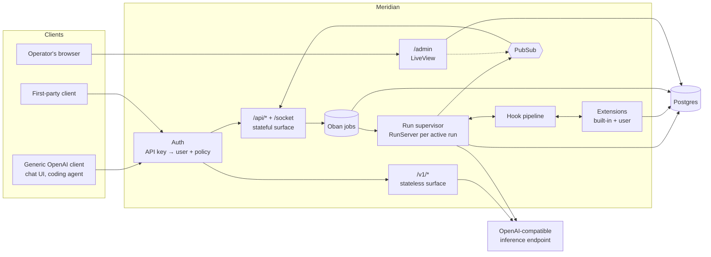
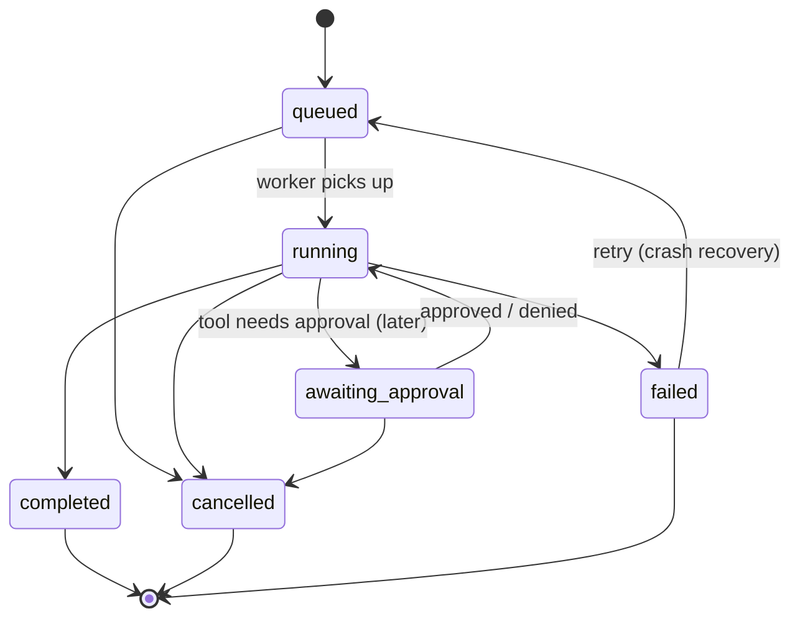

# Meridian — Design

> Status: draft / v0 planning. Nothing here is final; open questions are collected at the end.
>
> This document is a **direction, not a spec**. We build in thin, usable slices and let real
> features pull abstractions into existence. When the code and this doc disagree, we update
> whichever one is wrong, deliberately.

Meridian is a self-hostable **agent layer** that sits between clients and any OpenAI-compatible
inference endpoint. It owns identity, conversations, personas, and the agent run lifecycle, and
it is built to be **extended**. The inference backend is treated as a dumb, stateless model
endpoint.

From a client's point of view Meridian looks like an inference endpoint. The difference is that
**your API key carries *you***: your personas, your threads, and whatever your extensions add
(memory, tools, skills, ...).

## Goals

- **Durable conversations.** A response being generated must not depend on the client staying
  connected. Generation happens server-side; clients subscribe to it and can leave and come back.
- **Works with generic clients.** Any client that speaks the OpenAI Chat Completions API can use
  Meridian and get personas for free.
- **A richer native API** for first-party clients: server-side threads, durable runs, resumable
  event streams (SSE and WebSocket), multi-device.
- **Extensible by design.** The core is a small run lifecycle with hooks. Memory, tools, skills,
  and features we haven't thought of yet are extensions, not core rewrites.
- **Backend-agnostic and environment-agnostic.** No assumptions about where it runs or which
  inference server sits behind it. Everything is configured at deploy time.

## Non-goals (for now)

- Running models / being an inference server.
- Multi-agent orchestration (planners, sub-agents, agent-to-agent). The run model leaves room for
  it (`parent_run_id`), but it is out of scope.
- Autonomous / proactive behaviour. Meridian acts when a client calls it. Scheduled runs may come
  later (and could be an extension).
- Committing to a memory design. Memory is deliberately left to extensions (see
  [Memory](#memory)).
- Multi-tenant SaaS concerns (billing, signup flows, org management).

## Stack

| Concern            | Choice                                   |
|--------------------|------------------------------------------|
| Language / runtime | Elixir on the BEAM (OTP)                 |
| Web                | Phoenix (API + Channels), LiveView for the admin UI |
| Database           | PostgreSQL (+ `pgvector` available for extensions that want it) |
| Jobs / queue       | Oban (Postgres-backed)                   |
| Fan-out            | Phoenix.PubSub                           |
| HTTP client        | Req (with SSE parsing for streaming)     |
| Packaging          | `mix release` in a multi-arch (amd64 + arm64) container image |

Why Elixir: the core problem is long-lived, concurrent, crash-tolerant sessions that outlive
their client connections and fan out to multiple subscribers. That is what OTP is built for.

## Architecture overview



## The two surfaces

### 1. Stateless: `/v1/*` (OpenAI-compatible)

Deliberately dead simple: **a persona-aware proxy**. The client owns the conversation history
and the tool loop, exactly as with any OpenAI endpoint.

- `GET /v1/models`: lists **personas** as models (e.g. `meridian/default`, `meridian/coder`).
  Optionally also passes through raw upstream models (`EXPOSE_UPSTREAM_MODELS`).
- `POST /v1/chat/completions`: streaming and non-streaming.

Request handling:

1. Authenticate the key; resolve the persona from `model` (subject to key policy).
2. Prepend/append the persona's system prompt, apply its upstream model and default params.
3. Forward to upstream unchanged otherwise. Client tools pass through untouched.
4. Stream the response back. A client disconnect cancels the upstream request.

No server tools, no memory, no skills, no hook pipeline, no persistence. Extensions do not run on
this surface in v0. (Whether a small subset of hooks should run here is an open question.)

### 2. Stateful: `/api/*` + `/socket` (native)

For first-party clients. The server owns threads, history, and the run lifecycle. The full
extension pipeline runs here.

REST:

| Method & path                         | Purpose |
|---------------------------------------|---------|
| `GET/POST /api/threads`               | List / create threads |
| `GET/PATCH/DELETE /api/threads/:id`   | Read / update (title, persona, settings) / delete |
| `GET /api/threads/:id/messages`       | Paginated history |
| `POST /api/threads/:id/messages`      | Add a user message → returns `{message, run}` immediately |
| `GET /api/runs/:id`                   | Run status + usage |
| `GET /api/runs/:id/events`            | **SSE** event stream, resumable via `Last-Event-ID` / `?after=seq` |
| `POST /api/runs/:id/cancel`           | Cancel a run |
| `GET /api/threads/:id/events`         | SSE stream of all run events for a thread |
| `GET/POST/PATCH/DELETE /api/personas` | Manage personas |
| `GET /api/models`                     | Upstream models (cached), for building personas |
| `GET/POST/DELETE /api/keys`           | Mint / revoke API keys for yourself |
| `/api/ext/:extension/*`               | Routes mounted by extensions |

`POST /api/threads/:id/messages` accepts `if_busy: "queue" | "interrupt" | "reject"` for when the
thread already has an active run (default: `reject` with `409`). *Slice 2 implements only
`reject`; `GET /api/threads/:id/events`, personas, models, keys, and extension routes are not
built yet.*

WebSocket (Phoenix Channels at `/socket`, authenticated with an API key). *Not planned yet: no
client needs it; REST + SSE covers durable runs.*

- Join `thread:<id>` (optionally with `last_seq` per run) → replay missed events, then receive
  live events for every run on that thread.
- Join `run:<id>` with `last_seq` → same, scoped to one run.
- Client → server messages on the thread channel: `send_message`, `cancel`, and later `approve` /
  `deny` for tool approval.

**Browser clients are first-class.** CORS for `/v1` and `/api` is configured by
`CORS_ALLOWED_ORIGINS`. Since `EventSource` can't send an `Authorization` header, every run in
an API response carries an `events_token` (signed, valid for that run's events only, one hour,
tied to the issuing key) accepted as `?token=` on `GET /api/runs/:id/events`. A reconnect to a
finished run with nothing left to send gets `204`, so `EventSource` stops instead of
reconnecting forever.

SSE and Channels are two transports over the same event log and PubSub topics. Neither has
special semantics. SSE exists for simple clients and curl; Channels for rich clients that want
bidirectional communication on one connection.

A future option is to also expose this surface as the **OpenAI Responses API**
(`previous_response_id`, `background: true`), which maps closely onto threads + runs.

## Admin UI

A small **LiveView** app mounted at `/admin`, inside the same release. It is an operator console,
not a chat client.

- **Manage**: users, API keys (mint / revoke), personas.
- **Observe**: threads and runs (read-only), including a **live run view**. LiveView subscribes
  to the same PubSub topics as API clients, so you can watch events, tool calls, and hook activity
  as a run happens. This is the main debugging tool for runs and extensions.
- **Extensions** can mount their own admin pages (e.g. a memory browser).

### Admin authentication

Admin access belongs to the **operator of the deployment**, not to a Meridian user, so it uses
its own credentials. Either or both of these can be enabled; with neither, `/admin` is disabled
entirely.

- **Sign-in with the OIDC provider** (`OIDC_ISSUER`, `OIDC_CLIENT_ID`, optional
  `OIDC_CLIENT_SECRET`, `ADMIN_EMAILS`): authorization code flow with PKCE, `state`, and
  `nonce`. The ID token is verified (signature, issuer, audience, nonce); the operator gets in if
  the verified email is in `ADMIN_EMAILS`. The session stores the email, so removing it from
  `ADMIN_EMAILS` logs them out. Being able to sign in to the provider is not enough: the
  allowlist is what makes someone an operator.
- **`ADMIN_TOKEN`**: a long random secret provided by the deployment (e.g. a Kubernetes Secret,
  generated with `openssl rand -base64 48`), pasted into the login form and compared in constant
  time. Useful as a fallback when the provider is down. Sessions carry a hash of the token, so
  rotating it logs everyone out.

Either way the result is a signed, short-lived (12 h) session cookie scoped to `/admin`. Cookie
sessions exist only in the admin pipeline; the APIs stay bearer-only. The session cookie is
`SameSite=Strict`, which isn't sent on the provider's redirect back to the callback, so the
in-flight login (`state`, `nonce`, PKCE verifier) lives in its own short-lived, encrypted,
`SameSite=Lax` cookie, and the callback moves into the console with a same-site navigation (a
meta refresh) rather than a redirect.

This also solves bootstrapping: the operator creates the first user and API key from the admin
UI, so no special bootstrap command is needed.

## User area (`/me`)

Where users manage their own things, starting with their personas: create, edit (system prompt,
upstream model, default params, extensions and their settings), make default, delete. It is a
separate LiveView area next to `/admin`, not a restricted admin console, and uses the same
persona form (`MeridianWeb.PersonaFormComponent`). Any model the upstream offers can be picked,
as in the admin console. Users can't create other users or see anyone else's things; there is
still no signup.

- **Sign-in** is the OIDC provider only, on whenever user sign-in is (`OIDC_CLIENT_ID`); without
  it, `/me` is 404. The flow is the admin one (code + PKCE, `state`, `nonce`, flow cookie), with
  the redirect URI `/me/auth/callback`, and links the person to their user exactly like the other
  sign-ins (by verified email on a first sign-in; no user, no entry).
- **The session** is its own signed cookie, scoped to `/me` (14 days, `SameSite=Lax`), holding
  the user id and linked identity, so deleting the user or unlinking ends it. It is separate
  from the admin session and the `/api` sign-in cookie: `ADMIN_EMAILS` means nothing here, and a
  `/me` session never opens `/admin`. `/me` has its own LiveView socket (`/me/live`) for the
  same reason `/admin` does.
- Personas are loaded through `Personas.get_persona!(user, id)`, so another user's id is a 404.
- Browser apps find it as `account_url` in `GET /api/auth/session`.
- *Later:* self-service API keys, browsing your own threads.

### Access requests (`/me/request`)

A public page where anyone can leave their email (and optionally a name) to ask to be added,
so the operator can send friends a link instead of collecting emails by hand. It is styled
like xebec's login (its own `public.css`) and is on whenever `/me` is. The admin login uses
the same front-door look and mark (`MeridianWeb.BrandComponents`) in the console's green, so
the two can't be mistaken for each other. The same split runs through the rest: the admin
console is green (following the system's light or dark), and `/me`, its sign-in page
included, is xebec's amber. Both top bars carry the mark.

- A valid email always gets the same "request sent" answer, whether it already has a user, a
  request, or neither, so the page doesn't reveal who has access. Emails that have a user are
  never saved.
- **One request per email** (case-insensitive, a unique index). Asking again moves the existing
  request to the top of its list (`requested_at`), counts it ("Asked 3 times"), and takes the
  new name if one was given; it keeps its status. Lists are newest-asked first.
- The admin console lists requests as cards (`/admin/requests`), email first, then the name.
  **Accept** creates the user (name: theirs, or the start of their email) with a default
  persona on the model set at the top of the page (suggested: the newest user's), and deletes
  the request; they then sign in as usual. **Snooze** moves it to "Later", with no timer.
  **Reject** keeps it (so the same email can't keep asking) under "Rejected", where it can be
  restored.
- At most 200 open (pending or snoozed) requests; past that the page says it isn't taking
  requests. That bounds what a script filling in the form can do. There is no other rate
  limiting yet.
- This is still not signup: nobody gets in until the operator accepts.

## Runs: the durable execution model

A **run** is one agent turn: from a user message to a final assistant message, including any
number of model calls and tool calls in between. Each model call + its tool calls is a **step**.

### State machine



`awaiting_approval` exists in the state machine from day one but is unused in v0.

### Execution

1. `POST /messages` (or Channel `send_message`) inserts the user message and a `runs` row
   (`queued`) in one transaction and enqueues an Oban job. The response returns right away.
2. The Oban worker starts a `RunServer` (GenServer) under a `DynamicSupervisor`, registered in a
   `Registry` by `run_id`.
3. `RunServer` executes the agent loop, calling into the [hook pipeline](#hook-points) at each
   stage: build context → call model (streaming) → execute tool calls → append results → repeat
   until the model produces a final answer, a hook stops it, or a step limit is hit.
4. Every meaningful thing becomes an **event**: it is broadcast on PubSub (`run:<id>`,
   `thread:<id>`) immediately, and persisted to `run_events`.
5. On completion the final assistant message (and intermediate tool messages) are written to
   `messages`, the run is marked `completed`, and the `run_end` hook fires (where extensions can
   enqueue follow-up work such as memory reflection or title generation).

**One active run per thread** is enforced by a partial unique index on
`runs(thread_id) WHERE status IN ('queued','running','awaiting_approval')`.

### Event stream and resume

Events have a per-run monotonically increasing `seq`. To subscribe (SSE or Channel), a client
provides its last seen `seq`:

1. Subscribe to the PubSub topic first (buffering).
2. Replay persisted events with `seq > last_seq` from Postgres.
3. Flush the buffer, dropping anything already replayed (dedupe on `seq`), then tail live.

Token deltas are **coalesced** (every ~100 ms) into a single `message.delta` event, which is
persisted and broadcast like any other event, so live and replaying clients see the same events.

Core event types:

- `run.started`, `run.completed`, `run.failed`, `run.cancelled`
- `step.started`, `step.restarted`
- `message.delta` (text / reasoning content), `message.completed`
- `tool_call.started`, `tool_call.completed`
- `ext.<extension>.<name>`: namespaced events emitted by extensions (e.g.
  `ext.memory.recalled`)

### Crash recovery

OTP supervision handles in-process crashes, but a pod restart kills everything in memory, so
durability comes from Postgres:

- Completed steps (model output + tool results) are checkpointed when each step finishes.
- If a worker dies mid-run, Oban retries the job. The new `RunServer` loads the checkpointed
  steps, emits `step.restarted` (clients discard that step's partial text), and regenerates only
  that step.
- Tool calls that already completed are never re-executed.
- A janitor job marks runs stuck in `running` with a stale heartbeat as failed / retryable.

### Cancellation

Explicit, via REST or Channel. The cancel is broadcast on PubSub (works across nodes), the
`RunServer` aborts the upstream request, persists partial content, and emits `run.cancelled`.

## Extensibility

The goal is to be moddable in the way the [pi coding agent](https://github.com/badlogic/pi-mono)
is, without knowing up front what the mods will be. The design rule that keeps us from painting
ourselves into a corner:

> **The core only knows about runs, threads, personas, and the hook pipeline.
> Everything else, including our own features, is an extension built on the public extension
> API.**

If memory, skills, and title generation can be written as extensions, the API is good enough for
things we haven't thought of. If one of them needs to reach into the core, the API is missing
something and we fix the API, not add a special case.

### What an extension is

An extension is **middleware on the run lifecycle, plus a place to keep state and do background
work, switched on per persona.** Concretely: an Elixir module, compiled into the release, that
the core calls at fixed hook points during a run. Adding a feature means writing a module and
listing it in config, not editing the core, and not working around it with MCP servers, skills,
or prompt instructions. That matters for features like memory, which have to act without the
model asking (inject what it knows into every request, learn after a run ends); a tool or skill
only runs when the model decides to call it.

Unlike plain middleware:

- The hook points are fixed by the core. Each one is a contract the core keeps.
- Some hooks pass data through to be changed, some only observe, a few can halt.
- Extensions also live outside the chain: they own tables and run background jobs.

Every hook the run lifecycle can fire exists from the start, used or not (see
[Hook points](#hook-points)). Hooks that depend on core features that don't exist yet (the
tool loop) arrive with those features.

### What an extension can do

Modeled on pi's extension API, minus the client/UI parts (Meridian is a server):

| Capability                | Mechanism |
|---------------------------|-----------|
| Observe / modify the run lifecycle | Hook handlers (see below) |
| Provide model-callable tools | Register tools: name, description, JSON Schema params, `execute/2` |
| Contribute to the prompt  | `before_run` / `context` hooks (system prompt sections, injected messages) |
| Emit events to clients    | `emit/2` → `ext.<name>.<type>` in the run event stream |
| Own data                  | Its own Ecto migrations/tables, prefixed `ext_<name>_` |
| Background work           | Register Oban workers and cron entries |
| Expose an API             | Mount routes under `/api/ext/<name>/` |
| Admin pages               | Mount LiveViews under `/admin/ext/<name>/` |
| Configuration             | Declare a config schema; values come from deploy config, overridable per persona and per API key |
| Talk to other extensions  | Extension-scoped PubSub topics |

### Hook points

Hooks are called from the process where the lifecycle event happens: the `RunServer` for
everything inside a run. `run_end` fires once the run's final state is committed, from whichever
process ended it (the `RunServer`, the janitor, a cancel of a queued run), and never inside the
transaction. Each handler runs in its own supervised task with a timeout (5 s by default), in
priority order (then installation order). Each returns
`{:cont, value}` to pass a (possibly modified) value on, or `{:halt, reason}` where halting is
allowed.

Only extensions enabled on the run's persona are called (see
[Enablement](#enablement-and-configuration)). Every handler receives the value for its hook and
a context: the run, thread and user ids, the persona, and this extension's settings for that
persona.

| Hook               | Receives / may change | Can halt? | Available |
|--------------------|-----------------------|-----------|-----------|
| `run_start`        | Run, thread, persona. Observe; set up per-run state | No | v0 |
| `before_run`       | System prompt sections, tool set, model params for this run | Yes (reject run) | v0 |
| `context`          | The conversation history about to be sent, without the system prompt (inject, trim, summarize, rewrite) | No | v0 |
| `before_model_request` | The final upstream request body (model routing, params) | No | v0 |
| `model_stream_event` | Raw stream events. Read-only, must be fast | No | v0 |
| `tool_call`        | Tool name + arguments (rewrite) | Yes (block → error result to the model) | With the tool loop |
| `tool_result`      | Tool result (redact, transform). Chained | No | With the tool loop |
| `message_end`      | Finalized assistant message (replace content) | No | v0 |
| `step_end`         | Step boundary. May request one more model call (`continue`) | No | With the tool loop |
| `run_end`          | Final outcome. Observe; enqueue follow-up jobs (must return quickly) | No | v0 |
| `thread_created` / `thread_deleted` | Thread lifecycle | No | v0 |

Extensions use the core only through one facade, `Meridian.Extension.API` (read threads and
messages, update a thread, a non-streaming model call, ...), never the internal contexts. That
is what "built on the public extension API" means, and it is what the built-in extensions are
tested against. Extension background jobs run on a shared `extensions` Oban queue and must be
idempotent.

`before_run` gets the system prompt as a list of sections (the persona's first); they are joined
with blank lines, and the result goes first in the request as for `/v1` (merged into a leading
system message from `context`, if there is one).

Failure semantics (borrowed from pi): handlers are wrapped with a timeout and `try/rescue`. A
crashing, hanging, or invalid-returning **observer or chained handler** is logged and skipped
(fail-open): the next handler gets the value as it was. A crashing **`tool_call`** handler
blocks the tool (fail-closed). An extension crash never takes down the run, and never the node.

### How extensions are delivered

The extension *API* above is the contract. *Delivery* is a separate layer, and we can add
mechanisms over time without changing the contract:

1. **Elixir modules (v0).** An extension is a module implementing the `Meridian.Extension`
   behaviour (all callbacks optional). Enabled via config:
   `config :meridian, extensions: [Meridian.Ext.Title, MyCo.Ext.Honcho]`.
   - Built-ins live in this repo under `lib/meridian/ext/`.
   - Third-party extensions are Hex/git deps built into a custom image (a thin `Dockerfile`
     `FROM` the official one is enough).
   - Possibly: `.ex` files dropped into a mounted `EXTENSIONS_DIR` and compiled at boot (releases
     ship the Elixir compiler). This is the closest thing to pi's "drop a file in a folder", and
     works with a Kubernetes ConfigMap. The catch: such files can't bring their own deps.
2. **MCP servers (soon).** For *tools* specifically. Any MCP server, in any language, configured
   as an extension. Covers the most common extension need with zero Elixir.
3. **Remote extensions (later).** Hooks delivered over a protocol (JSON-RPC over WebSocket or
   HTTP) to an out-of-process service, so extensions can be written in Rust, TypeScript, etc.
   Pays network latency per hook, so subscriptions are explicit ("I only want `run_end`").
4. **WASM (maybe, spicy).** Sandboxed extensions via Wasmex (wasmtime). Untrusted code with
   capability limits, written in Rust/TS/etc. Only worth it if we ever want to run extensions we
   don't trust.

Trust model: options 1 and 2 (local) are fully trusted, the same as pi: they run with Meridian's
permissions and see everything. Remote extensions see only what their hook subscriptions send.

### Enablement and configuration

- **Installed** = in the release and listed in deploy config: the library of extensions.
  **Enabled** = switched on for a given persona. Nothing is on by default; since personas belong
  to users, a user who doesn't want an extension simply doesn't enable it.
- `personas.extensions` maps each enabled extension's name to its settings. Present means
  enabled: `{"datetime": {"timezone": "Europe/Stockholm"}, "title": {}}`.
- Each extension declares the settings it accepts and their defaults. The admin persona form
  lists every installed extension with an on/off toggle and its settings, validated on save.
- Settings are frozen into the run with the rest of the persona (`runs.persona_snapshot`), so
  changing a persona never affects a run in flight.
- A persona that lists an extension that isn't installed (anymore) keeps the entry, but it is
  ignored at run time and shown as "not installed" in the admin UI.
- *Later:* API key policies further restricting or configuring extensions (e.g. read-only memory
  for a coding agent's key), merged over persona settings. Deferred: it requires runs to record
  which key started them.

## Identity: users, API keys, policies

- **Users** are generic: id, display name, email (required, unique case-insensitively, since
  it is how a first sign-in finds its user). There is no signup. Users are
  created by the operator in the [admin UI](#admin-ui), by hand or by accepting an
  [access request](#access-requests-merequest).
- **API keys** identify a user to clients, one per client/purpose. Minted in the admin UI (and
  later self-service via `/api/keys`). Format `mrd_<random>`, shown once, stored as a SHA-256
  hash with a short visible prefix.
- **OIDC access tokens** (optional, `OIDC_AUDIENCES`) identify a user to first-party clients
  that let people sign in. Meridian is only a *resource server*: the client runs the login with
  the provider and sends the access token as `Authorization: Bearer`, exactly where an API key
  would go. Meridian verifies it (RS256 against the provider's JWKS; issuer; audience is one of
  `OIDC_AUDIENCES`; expiry) and looks up the user by `(oidc_issuer, oidc_subject)`. A subject
  seen for the first time is linked to the user whose email matches the provider's userinfo
  (unless marked unverified); a user already linked to another identity is never relinked, and
  without a matching user the request is refused. The operator can unlink in the admin UI.
  Signed-in users get the default policy (all their personas). Run events tokens are tied to
  the user instead of a key. Access tokens aren't checked for revocation; they are short-lived.
- **Sign-in sessions** (on whenever `OIDC_CLIENT_ID` is set) are for browser apps without a backend,
  such as xebec. They can't run the login themselves: the code-for-token exchange is a browser
  request to the provider's token endpoint, which needs CORS from the provider, and WorkOS
  doesn't allow it for OAuth applications. So Meridian runs it under `/api/auth` (login,
  callback, session, logout), exactly like admin sign-in, links the user the same way, and keeps
  a signed cookie (`SameSite=Lax`, path `/api`, 14 days) with the user id and linked identity;
  deleting the user or unlinking ends it. `/api` accepts the cookie when there is no bearer
  token. The app must be on Meridian's origin (its reverse proxy forwards `/api`); CORS still
  never allows credentials. Requests that change something need `X-Requested-With`, so a sibling
  subdomain (same site, so the cookie goes along) can't forge them with a plain form.
- **Client contract.** Whatever the credential, a client sends one bearer token and gets a
  user. Browser apps on Meridian's origin may send the sign-in cookie instead. Meridian knows nothing about specific clients or how they got their token, so any
  number of clients can share it. Generic OpenAI clients use API keys; apps with a sign-in
  button use the provider.
- Credentials are never mixed between roles: **API keys** and **OIDC access tokens**
  (users → APIs), **`/me` sign-in** (users → their own `/me`), and **admin sign-in** or the
  **admin token** (operator → `/admin`). Signing in to a client or to `/me` never grants admin
  access.
- Each key carries a **policy**:

```jsonc
{
  "default_persona": "coder",            // used if the client sends an unknown/generic model
  "allowed_personas": ["coder", "default"],
  "extensions": {                         // per-extension overrides (native surface, later)
    "memory": { "scopes": ["coding"], "write": "explicit" }
  }
}
```

## Personas

A persona is a named bundle presented to clients as a model:

- `slug` (→ model id `meridian/<slug>`), display name
- system prompt
- upstream model + default params (temperature, max tokens, ...)
- enabled extensions + their per-persona config

On create/update, the upstream model is **validated against the provider's `/v1/models`**
(cached briefly). Passing `force: true` skips validation, for upstreams that don't list all
models or that are temporarily down.

Personas belong to a user. A default persona is created along with each new user.

## Memory

Memory is deliberately **not part of the core**. It's an open design space (vector store,
knowledge graph, an external service like Honcho, reflective vs. explicit writing), and we don't
want to commit to one answer yet.

The hook pipeline is designed so that any of these is possible as an extension:

- **Read**: `context` / `before_run` to retrieve and inject; `emit` to show clients what was
  recalled.
- **Write explicitly**: register `remember` / `recall` / `forget` tools.
- **Write reflectively**: `run_end` → enqueue an Oban job that extracts memories.
- **External service** (e.g. Honcho): same hooks, but the extension calls out to the service
  instead of owning tables.
- **Inspect / edit**: mount routes under `/api/ext/memory/`.

`pgvector` should be available in the database so a local memory extension can use it, but the
core schema doesn't depend on it.

Writing a first memory extension is the real test of the extension API.

## Data model (core, first pass)

All ids are UUIDv7 (time-ordered). Timestamps are `utc_datetime_usec`.

```text
users           id, name, email, oidc_issuer?, oidc_subject?, inserted_at
api_keys        id, user_id, name, prefix, token_hash, policy jsonb, last_used_at, revoked_at
personas        id, user_id, slug, name, system_prompt, model, params jsonb,
                extensions jsonb, is_default
threads         id, user_id, persona_id, title, settings jsonb, archived_at, inserted_at, updated_at
messages        id, thread_id, run_id?, parent_id?, role, content jsonb (parts),
                tool_calls jsonb?, tool_call_id?, metadata jsonb, usage jsonb?, inserted_at
runs            id, thread_id, user_message_id, parent_run_id?, status, persona_snapshot jsonb,
                model, step_count, usage jsonb, error jsonb?, heartbeat_at,
                started_at, finished_at
run_steps       id, run_id, index, status, request jsonb, response jsonb, tool_results jsonb
run_events      run_id, seq, type, payload jsonb, inserted_at        -- PK (run_id, seq)
extension_state extension, scope_type, scope_id, key, value jsonb   -- simple KV for extensions
                                                                    -- that don't need tables
```

Notes:

- Slice 2 created `threads`, `messages`, `runs`, and `run_events` with only the columns in use
  (see the decision log); the rest are added when a feature needs them.
- `messages.parent_id` allows edit-and-regenerate / branching later without a schema change.
- `messages.metadata` gives extensions a place to annotate messages without schema changes.
- `runs.persona_snapshot` freezes the persona config (including extension config) used.
- `run_events` can be pruned after a retention period, since final messages live in `messages`.

## Configuration

Everything environment-specific comes from env vars. Nothing about any particular deployment
is in the repo.

| Variable               | Purpose |
|------------------------|---------|
| `DATABASE_URL`         | Postgres connection |
| `SECRET_KEY_BASE`      | Phoenix secret |
| `PHX_HOST`, `PORT`     | Public host / listen port |
| `LLM_BASE_URL`         | OpenAI-compatible upstream, e.g. `https://example.com/v1` |
| `LLM_API_KEY`          | Upstream key (optional) |
| `EXPOSE_UPSTREAM_MODELS` | Also list raw upstream models in `/v1/models` (default `false`) |
| `CORS_ALLOWED_ORIGINS` | Browser origins allowed to call `/v1` and `/api` (comma-separated, or `*`). Unset = none |
| `ADMIN_TOKEN`          | Enables `/admin`; the secret used to log in. Unset (and no admin sign-in) = admin disabled |
| `OIDC_ISSUER`          | OIDC provider for sign-in (admin and clients), exactly as its tokens' `iss` |
| `OIDC_CLIENT_ID`, `OIDC_CLIENT_SECRET` | Meridian's client at the provider, for admin and user sign-in (the secret only for confidential clients). Also turns on `/me` |
| `ADMIN_EMAILS`         | Emails allowed into `/admin` via sign-in (comma-separated); unset = admin sign-in off |
| `OIDC_AUDIENCES`       | Client ids whose access tokens `/v1` and `/api` accept. Unset = API keys only |
| `EXTENSIONS_DIR`       | Optional directory of `.ex` extensions compiled at boot (if we do that) |

Extensions declare and read their own config.

## Deployment

- Multi-stage Dockerfile building a `mix release`; CI builds a multi-arch image
  (`linux/amd64`, `linux/arm64`) with `docker buildx`.
- Migrations (core + enabled extensions) run via a release command / init container.
- Requires Postgres (with `pgvector` installed if extensions use it).
- Kustomize bases in `deploy/` (`app/`, and an optional `postgres/`); see `deploy/README.md`.
  Hosts, secrets, and the image tag belong in an overlay in the operator's own infrastructure
  repo.
- The image is public on GHCR, so clusters pull it without credentials.
- Single node first; PubSub and `Registry` are designed so clustering (`libcluster`) is possible
  later without redesign.

## Testing approach

- A fake OpenAI-compatible upstream (Bypass / a small Plug) that scripts streamed responses,
  tool calls, delays, and failures, so the run lifecycle can be tested deterministically.
- Crash-recovery tests: kill a `RunServer` mid-step, assert it resumes correctly.
- Resume tests (SSE and Channels): disconnect, reconnect with `last_seq`, assert no gaps or
  duplicates.
- Extension tests: a test helper that runs a fake run through the hook pipeline with a given set
  of extensions, so extension authors can test without a database or upstream.

## Milestones

Each slice should end with something usable, not just a layer.

**Slice 0: skeleton** ✅

- Phoenix (API), Ecto, Oban, Req, health probes, Dockerfile, CI + multi-arch image, compose
  for local Postgres.

**Slice 1: usable persona proxy.** ✅ *Done when: pi (or any OpenAI client) talks to an upstream
model through Meridian, using a persona.*

1. Admin UI skeleton: LiveView plumbing, `ADMIN_TOKEN` login.
2. Users + API keys (schemas, admin pages, API-key auth plug).
3. Upstream client (`/v1/models`, streaming chat completions via Req).
4. Personas (schema, admin pages, upstream model validation with `force`).
5. `/v1/models` + `/v1/chat/completions` persona proxy (streaming).

**Slice 2: durable conversations.** ✅ *Done when: a first-party client can send a message, quit,
reconnect, and see the full reply.*

1. Threads, messages, runs, `RunServer`, event log.
2. REST + resumable SSE, cancellation.
3. Live run view in the admin UI.

Deferred from slice 2 (see the decision log): crash recovery by resuming runs (`run_steps`,
`step.restarted`), `if_busy: queue | interrupt`, the thread-level SSE stream.

**Slice 3: extension API v0.** ✅ *Done when: two built-in extensions, enabled per persona, work
using only the public extension API.*

1. `Meridian.Extension` behaviour, the hook pipeline (every v0 hook in
   [Hook points](#hook-points), with timeouts and fail-open/closed semantics), and the
   `Meridian.Extension.API` facade.
2. Per-persona enablement and settings, including the admin persona form.
3. `datetime` extension: adds the current date and time to the system prompt (`before_run`
   hook), with a per-persona timezone setting.
4. `title` extension: after a thread's first completed run, a background job asks the model for
   a title and sets it only if the thread still has none (`run_end` hook, Oban job, model call
   from an extension). Clients see it the next time they fetch the thread.

**Slice 4: memory extension.** Design TBD (including whether personas share memories). Adds
extension-owned tables; the real stress test of the extension API.

**Next**
- Tools from extensions + MCP-backed tools
- Skills extension
- Tool approval (`awaiting_approval`)

**Later**

- Phoenix Channels transport (WebSocket), and the thread-level SSE stream
- `EXTENSIONS_DIR` runtime loading, remote extensions, maybe WASM
- Responses API surface
- Scheduled runs

## Decision log

Decisions we've made and why, including what we rejected, so they aren't reopened by accident.
Add an entry whenever a decision is made or reversed.

| Decision | Rejected alternatives | Why |
|---|---|---|
| **Elixir/OTP** | TypeScript, Rust, Python | The core problem (long-lived, crash-tolerant sessions that outlive connections and fan out to subscribers) is what OTP is built for. TS has no particular fit; Rust adds a lot of async ceremony for I/O-bound work where the heavy compute lives in the inference server. Python was ruled out by preference. |
| **Postgres + Oban for jobs, PubSub for fan-out** | Redis/NATS, Temporal/Restate | One stateful dependency to operate. Oban gives a durable queue (`SKIP LOCKED`), retries, and cron on Postgres. Temporal-style durable execution is overkill for a single-operator deployment; the `RunServer` boundary keeps the option open. |
| **Two surfaces: stateless `/v1` + stateful `/api`** | Stateful only; OpenAI-compat only | Generic clients (chat UIs, coding agents) only speak stateless Chat Completions; durable threads need server-owned state. Same personas, different lifecycle owner. |
| **Stateless `/v1` is a pure persona proxy** | Server tools/memory on `/v1` | Mixing server and client tool calls in one stateless response is messy (every tool call needs a result the client doesn't have; server tool exchanges vanish from the client's history). Keep it dead simple; revisit later (open question 1). |
| **Personas exposed as model ids** | Custom headers, per-key persona only | Works in every OpenAI client without changes: pick `meridian/<persona>` as the model. |
| **Memory is an extension, not core** | Building pgvector memory into core | The memory design (vector store, graph, Honcho, reflective vs. explicit) is undecided. Making it an extension defers the choice and tests the extension API. |
| ~~**Core features are extensions; hooks added on demand**~~ *Reversed in slice 3, see below* | Designing the full hook API up front | Keeps the extension API real (proven by our own features) without building speculative hooks. |
| **One callback per hook** | A single `handle_hook/3` | Discoverability and Dialyzer. Remote extensions get a generic form at the protocol boundary. |
| **SSE + Phoenix Channels over one event log** | SSE only; WebSocket only | SSE for simple clients/curl, Channels for rich bidirectional clients. Neither has special semantics. |
| **Admin UI is LiveView in the same release** | Separate SPA (e.g. TS) | One deployable, no extra API client or CORS. The live run view subscribes to the same PubSub topics as clients. No Node toolchain: the LiveView JS can be served from the dependency. |
| **Admin auth via deployment secret `ADMIN_TOKEN`** | Admin scope on user API keys, user passwords | Operating the instance and using it are different roles with different credentials. Also removes the need for a bootstrap command. |
| **OIDC sign-in for admin, with an `ADMIN_EMAILS` allowlist; `ADMIN_TOKEN` stays as an optional fallback** | WorkOS-specific integration (its User Management API or SDK); a proxy in front (oauth2-proxy, Cloudflare Access); token only | No long secret to keep and paste. Generic OIDC works with WorkOS AuthKit and any other provider, so deployments pick their own. The allowlist is needed because a provider only says who someone is, not that they operate this instance. Hand-rolled with Req and `:crypto` (RS256 only) instead of a JOSE dependency. |
| ~~**Clients may authenticate with OIDC access tokens; Meridian is a resource server, not an authorization server**~~ *Amended, see "Meridian runs the login for browser apps" below* | Meridian running the login and minting its own tokens or API keys per client; cookie sessions for `/api` | Keeps one client contract (a bearer token) and keeps Meridian ignorant of clients. Clients use the provider's SDKs; Meridian only verifies. No cookies keeps the CORS reasoning intact. API keys stay for generic clients. |
| **Sign-ins link to existing users by verified email; no signup** | Auto-creating users on first sign-in; the operator entering provider subject ids | Users stay operator-created. Email is what the operator already knows; the subject is stored on first sign-in so later changes to the email don't move the account. Never relinking a linked user stops a new identity with the same email from taking over. |
| **Meridian runs the login for browser apps, with a cookie session on `/api`** (amends "Meridian is a resource server") | The app proxying the provider's token endpoint to get around CORS; a separate backend per app; the provider's browser SDK (a different WorkOS product, with its own tokens) | A static app can't trade the code for tokens: WorkOS's token endpoint doesn't send CORS headers for OAuth applications. Meridian already runs this flow for `/admin` and owns users and identities, so it owns the whole sign-in and apps stay ignorant of the provider. The cookie is same-origin only, so the CORS reasoning holds. Access tokens (`OIDC_AUDIENCES`) stay for clients that log in themselves. |
| **One OIDC client for admin and user sign-in** (`OIDC_CLIENT_ID`/`OIDC_CLIENT_SECRET`; amends the two entries above) | Separate admin and user clients (`ADMIN_OIDC_CLIENT_*`, `USER_OIDC_CLIENT_*`) | Both flows are Meridian signing someone in, so they are one app at the provider with two redirect URIs; two clients only meant two of each setting. What separates the roles is `ADMIN_EMAILS`, not the client: a user sign-in never creates an admin session, and admin sign-in is off without the allowlist. The old variable names fail at boot with a pointer to the new ones. |
| **Generic and environment-agnostic** | Assuming a specific inference server or cluster | Public project. Everything deployment-specific comes from env vars; deployment values live in the operator's own infrastructure repo. |
| **Persona resolution on `/v1`**: `meridian/<slug>` → that persona (404 if unknown or not allowed); a raw upstream id → passthrough when `EXPOSE_UPSTREAM_MODELS`; anything else → the key's `default_persona`, else the user's default persona | Rejecting unknown models; falling back for unknown `meridian/` slugs too | Clients with a hardcoded model name (`gpt-4o`) still work, but a typo in an explicit persona id fails loudly instead of silently using the wrong persona. |
| **Persona system prompt goes first, merged into the client's leading system/developer message** | A separate extra system message; appending after the client's | Some chat templates reject more than one system message or one that isn't first. The persona's identity comes before the client's (e.g. a coding agent's) instructions. |
| **Persona params are defaults; client values win** | Persona params override the client | Clients tune per-request (e.g. temperature for tool calls); personas set sensible defaults. `model` and `messages` can't be persona params. |
| **`/v1` relays the upstream response byte-for-byte** (status, content type, body; one path for streaming and non-streaming) | Parsing SSE and re-encoding; rewriting `model` in responses | Dead simple and transparent. Upstream errors reach the client unchanged. A client disconnect fails the next write, which cancels the upstream request. |
| **Upstream model list cached for 60 s** (validation and `/v1/models`) | No cache; long cache | Partly answers open question 6. Short enough that new upstream models show up quickly. |
| **The default persona's model is chosen when creating a user** | A `DEFAULT_MODEL` env var; personas with no model | Every user needs a working default persona immediately, and there's no deployment-wide "right" model. |
| **Admin UI has no asset build**: hand-written CSS, Phoenix/LiveView JS served from the deps | Tailwind/esbuild | No Node or asset toolchain for a small operator console. Lets the CSP forbid inline scripts. |
| **Multi-arch images built on native runners** | QEMU emulation | Deployments may mix amd64 and arm64 nodes. Native arm64 GitHub runners are much faster than emulation. |

| **Deltas are coalesced before broadcast, not just before persistence** (one `message.delta` per ~100 ms, configurable) | Broadcasting every token live and persisting coalesced deltas | One event stream with one `seq` sequence: live and replaying clients get identical events, and resume/dedupe stays trivial. 100 ms is still smooth to read. |
| **Runs aren't retried or resumed yet** (slice 2): a crashing `RunServer` or a shut-down node fails the run (`interrupted`); a janitor fails runs whose heartbeat is older than 60 s | Oban retries + checkpointed steps now | Runs are a single model call until tools exist, so there's no completed step to resume from. Failing fast frees the thread (one active run per thread) instead of leaving it stuck. Resume comes with `run_steps`. |
| **Leaner first data model**: no `run_steps`, `parent_id`, `tool_calls`, `settings`, `archived_at`, `parent_run_id`, `step_count` yet | Creating every column from the design up front | Nullable columns are cheap to add when a feature needs them; unused ones invite half-semantics. |
| **Cancelled replies are kept**: the partial text is saved as the assistant message (`metadata.finish_reason: "cancelled"`) and is part of later context | Discarding partial output | Matches what chat UIs do, and the user saw that text. |
| **Reasoning is stored as a `reasoning` content part and never sent back upstream** | Dropping it; storing it in metadata | Clients and the admin UI can show it; chat templates generally expect reasoning to be stripped from history. |
| **`POST /messages` only supports `if_busy: reject` (409) for now; deleting a thread with an active run is also a 409** | Queue/interrupt now; cancel-then-delete | Clients can cancel and retry explicitly. Keeps the one-active-run invariant simple until a client needs more. |
| **The native API uses the same error shape as `/v1`** (`{"error": {"message", "type", "code"}}`) | A separate error format | One shape for clients to handle; the API key plug is shared. |
| **Browser apps are first-class clients: CORS via `CORS_ALLOWED_ORIGINS`, never with credentials, never on `/admin`** | No CORS (same-origin or native clients only); a CORS dependency | APIs authenticate only with bearer keys, never cookies, so allowing an origin (even `*`) doesn't let a page act for anyone whose key it doesn't have. Requested headers are allowed as asked (SDKs send their own `x-` headers). A small plug, no new dependency. |
| **`EventSource` authenticates with a run-scoped `events_token` in the query string** | API key in the query string; requiring `fetch`-based SSE | Keys in URLs end up in proxy logs and history. A signed token that only reads one run's events, expires in an hour, and dies with its key limits that exposure. `fetch` with the header also works. `token` is filtered from Phoenix logs. |
| **A finished run's stream answers a reconnect with `204`** | Holding the connection open; `200` with an empty body | `EventSource` reconnects whenever a stream ends; `204` is the spec's signal to stop. |
| **The `RunServer` never blocks on the upstream**: the request runs in a linked helper process (`Meridian.Upstream.Stream`) that forwards the response as messages | Calling `Req` (`into: :self`) from the `RunServer` | `Req` blocks its caller until response headers arrive, which can take minutes. A blocked `RunServer` can't handle cancels or send heartbeats, so the janitor would fail a live run. The same rule applies to any future work that waits on external services (tools, extension calls). |
| **A run only completes if the upstream reported a `finish_reason`**; a stream that ends without one, or contains an event that isn't valid JSON, fails the run (`upstream_incomplete` / `upstream_error`) and saves no reply. `[DONE]` is not required if a finish reason arrived | Treating the end of the HTTP body as success; skipping malformed events | A dropped connection must not be saved as a complete answer, especially once `run_end` hooks act on completed runs. Partial text is only kept for cancels, where the user chose to stop. |
| **UUIDv7 ids are generated with monotonic precision** | Millisecond precision | Messages are ordered by id; ids created within the same millisecond must still sort in creation order. |
| **Every hook the run lifecycle can fire exists from v0, used or not** (replaces "hooks added on demand"). Tool hooks and `step_end` come with the tool loop | Adding each hook only when an extension needs it | Extensions should be able to hook anything in the lifecycle without a core change first; that is the point of the API. Unused hooks are covered by tests instead of a consumer. Core features remain extensions. |
| **Extensions are enabled per persona, off by default**; `personas.extensions` maps name → settings (present = enabled), frozen into the run's persona snapshot | Global enablement; on-by-default extensions | Users and personas differ (memory on one persona only, or not at all). Since personas belong to users, this also gives per-user control. |
| **API key policy overrides for extensions are deferred** | Building deploy → persona → key merging now | Runs don't record which key started them, so background work couldn't apply the key layer. Per-persona settings cover the need for now. |
| **Extensions call the core only through `Meridian.Extension.API`** | Extensions calling internal contexts (`Threads`, `Upstream`) | Gives "built only on the public extension API" a real meaning and keeps the core free to change internally. |
| **`run_end` fires after the run's final state is committed, from whichever process ended it** | Only from the `RunServer` | Runs also end in the janitor, the worker (crash), and when a queued run is cancelled. Every end fires the hook exactly once, and handlers never run inside the transaction. |
| **Hook handlers run in a supervised task with a timeout, not in the caller** | `try/rescue` in the calling process | A handler that hangs can't stall the `RunServer` (it must keep handling cancels and heartbeats), and a crash can't take the caller down. Spawning a process is cheap on the BEAM; handlers that aren't implemented cost nothing. |
| **Extension settings are edited as JSON per extension** in the admin persona form | A typed settings schema rendered as fields | One generic form for every extension, like persona params. Extensions validate their own settings (`validate_settings/1`). A schema can come later if the JSON gets in the way. |
| **Thread hooks use the persona's current settings** | Freezing them | There is no run to freeze them in. |
| **Generated titles don't bump `updated_at` and aren't pushed to clients** | A `thread.updated` event | A title isn't activity, so the thread shouldn't move up the list. Clients see it on their next fetch; a push can come with a thread-level event stream. |
| **Development reads `.env` itself** (in `config/runtime.exs`; shell variables win); releases and tests only use real environment variables | `source`/`set -a` by hand; direnv; a dotenv library | Running locally shouldn't need shell tricks. A dozen lines cover `KEY=value` files without a dependency, and deployments keep config in the platform's environment, not in files. |
| **Timezones via the `tz` package** | UTC offsets only | Elixir only ships UTC. Named zones with daylight saving need a timezone database; `tz` is small and has no runtime dependencies. |
| **Slice 3 is proven by two tiny extensions (`datetime`, `title`); memory gets its own slice; Channels are dropped for now** | Title generation alone; memory in slice 3; Channels in slice 3 | Titles alone only exercise `run_end`. Memory's design (e.g. shared across personas or not) is a memory question, not an API one. No client needs WebSockets yet. |
| **Kubernetes manifests are kustomize bases** (`deploy/app`, `deploy/postgres`) that overlays reference by URL; configuration comes from generated ConfigMaps/Secrets | A Helm chart; manifests only in the operator's repo; building images on a cluster node | Plain YAML with no templating to learn, and overlays keep every deployment-specific value out of this public repo. Generated names roll the Deployment when config changes. CI already builds multi-arch images in about two minutes, so nodes only ever pull. |
| **Health probes are exempt from `force_ssl`** | Probing over HTTPS; a separate probe port | kubelet calls the pod over plain HTTP and counts a redirect to another host as success, so `/readyz` would pass with the database down. |
| **Users manage their own personas in `/me`, a LiveView area separate from `/admin`** | User roles inside `/admin`; only a JSON API for clients (e.g. xebec) to build on | Keeps operating and using Meridian as different roles with different sessions: a bug in `/me` can't open `/admin`. Lives in the release (no client needed, no asset build) and reuses the admin persona form and the sign-in Meridian already runs. A JSON API for personas can come later on the same user-scoped domain functions. |
| **`/me` signs in with the OIDC provider only, into its own `SameSite=Lax` cookie** | Reusing the `/api` sign-in cookie; `SameSite=Strict` with a meta-refresh callback like `/admin` | The `/api` cookie is scoped to `/api` and checked differently (`X-Requested-With`); LiveView needs a real session. Lax keeps people signed in when they follow a link to `/me` from an app; forms and the LiveView socket carry CSRF tokens, and the callback can simply redirect. |
| **Users may pick any upstream model in `/me`** | An operator-defined allowlist of models | Nobody needs a limit yet; it can be added when someone does. |
| **A public access request page; the operator accepts, snoozes, or rejects in the admin console** (keeps "no signup") | Signup; the operator collecting emails by hand; invite links | Lets friends ask without the operator typing their details, while users are still only ever created by the operator. Accepting reuses user creation, so the request holds nothing but an email and a name. |
| **Request answers don't depend on the email; rejected requests are kept; open requests are capped at 200** | Telling people they already have access; deleting rejected requests; rate limiting by IP | The page is public, so it mustn't reveal who uses Meridian. Keeping rejections stops the same email from asking again. A cap is a dependency-free bound on abuse; IP rate limiting can come if it's needed. |
| **Asking again bumps the existing request; it keeps its status** | Ignoring repeats; a row per request; un-snoozing or un-rejecting on a repeat | No duplicates in the list, but the operator still sees that someone asked again, and when. An upsert on the email index makes it one statement, so simultaneous requests can't make two rows. Repeats don't undo the operator's snooze or reject. |
| **Snooze just moves a request to "Later"** | Snoozing for a set time | It means "I'll look at this later"; a timer would decide "later" for the operator. |
| **Accepting asks for the default persona's model once, at the top of the requests page** | A model field per card; going through the new-user form | Every user needs a default persona with a model; one page-level choice (prefilled with the newest user's model) keeps accepting to one click. |

## Open questions

1. **Hooks on the stateless surface.** Should a minimal subset (e.g. `before_model_request`) run
   on `/v1/*` eventually, or does that surface stay a pure persona proxy forever?
2. ~~**Hook API shape.**~~ Decided: one optional callback per hook (`before_run/2`, `context/2`,
   ...), for discoverability and Dialyzer. Remote extensions get translated to a generic
   `{hook, payload}` message at the protocol boundary.
3. **Extension migrations.** Run all installed extensions' migrations at boot, or only enabled
   ones? How do we handle uninstalling an extension that owns tables?
4. **Per-run extension state.** Does it live in the `RunServer` (lost on crash, rebuilt in
   `run_start`), or does the pipeline checkpoint it along with steps?
5. **Ordering and conflicts.** Is priority + registration order enough, or do extensions need to
   declare dependencies on each other?
6. **Persona model validation cache.** ~~How long to cache upstream `/v1/models`~~ (60 s), and
   should personas whose model disappears be flagged?
