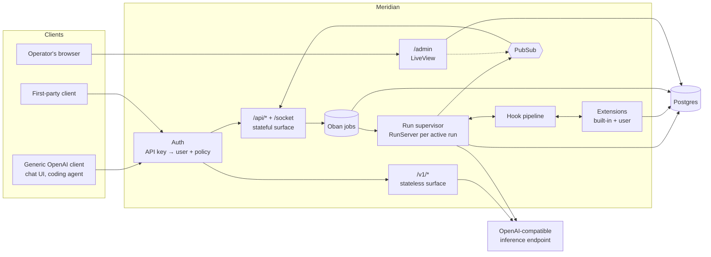
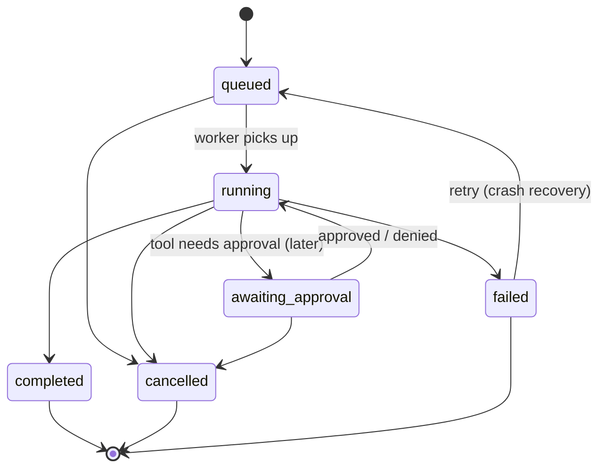

# Meridian — Design

> Status: draft / v0 planning. Nothing here is final; open questions are collected at the end.
>
> This document is a **direction, not a spec**. We build in thin, usable slices and let real
> features pull abstractions into existence. When the code and this doc disagree, we update
> whichever one is wrong, deliberately.

Meridian is a self-hostable **agent layer** that sits between clients and any OpenAI-compatible
inference endpoint. It owns identity, conversations, personas, and the agent run lifecycle, and
it is built to be **extended**. The inference backend is treated as a dumb, stateless model
endpoint.

From a client's point of view Meridian looks like an inference endpoint. The difference is that
**your API key carries *you***: your personas, your threads, and whatever your extensions add
(memory, tools, skills, ...).

## Goals

- **Durable conversations.** A response being generated must not depend on the client staying
  connected. Generation happens server-side; clients subscribe to it and can leave and come back.
- **Works with generic clients.** Any client that speaks the OpenAI Chat Completions API can use
  Meridian and get personas for free.
- **A richer native API** for first-party clients: server-side threads, durable runs, resumable
  event streams (SSE and WebSocket), multi-device.
- **Extensible by design.** The core is a small run lifecycle with hooks. Memory, tools, skills,
  and features we haven't thought of yet are extensions, not core rewrites.
- **Backend-agnostic and environment-agnostic.** No assumptions about where it runs or which
  inference server sits behind it. Everything is configured at deploy time.

## Non-goals (for now)

- Running models / being an inference server.
- Multi-agent orchestration (planners, sub-agents, agent-to-agent). The run model leaves room for
  it (`parent_run_id`), but it is out of scope.
- Autonomous / proactive behaviour. Meridian acts when a client calls it. Scheduled runs may come
  later (and could be an extension).
- Committing to a memory design. Memory is deliberately left to extensions (see
  [Memory](#memory)).
- Multi-tenant SaaS concerns (billing, signup flows, org management).

## Stack

| Concern            | Choice                                   |
|--------------------|------------------------------------------|
| Language / runtime | Elixir on the BEAM (OTP)                 |
| Web                | Phoenix (API + Channels), LiveView for the admin UI |
| Database           | PostgreSQL (+ `pgvector` available for extensions that want it) |
| Jobs / queue       | Oban (Postgres-backed)                   |
| Fan-out            | Phoenix.PubSub                           |
| HTTP client        | Req (with SSE parsing for streaming)     |
| Packaging          | `mix release` in a multi-arch (amd64 + arm64) container image |

Why Elixir: the core problem is long-lived, concurrent, crash-tolerant sessions that outlive
their client connections and fan out to multiple subscribers. That is what OTP is built for.

## Architecture overview



## The two surfaces

### 1. Stateless: `/v1/*` (OpenAI-compatible)

Deliberately dead simple: **a persona-aware proxy**. The client owns the conversation history
and the tool loop, exactly as with any OpenAI endpoint.

- `GET /v1/models`: lists **personas** as models (e.g. `meridian/default`, `meridian/coder`).
  Optionally also passes through raw upstream models (`EXPOSE_UPSTREAM_MODELS`).
- `POST /v1/chat/completions`: streaming and non-streaming.

Request handling:

1. Authenticate the key; resolve the persona from `model` (subject to key policy).
2. Prepend/append the persona's system prompt, apply its upstream model and default params.
3. Forward to upstream unchanged otherwise. Client tools pass through untouched.
4. Stream the response back. A client disconnect cancels the upstream request.

No server tools, no memory, no skills, no hook pipeline, no persistence. Extensions do not run on
this surface in v0. (Whether a small subset of hooks should run here is an open question.)

### 2. Stateful: `/api/*` + `/socket` (native)

For first-party clients. The server owns threads, history, and the run lifecycle. The full
extension pipeline runs here.

REST:

| Method & path                         | Purpose |
|---------------------------------------|---------|
| `GET/POST /api/threads`               | List / create threads |
| `GET/PATCH/DELETE /api/threads/:id`   | Read / update (title, persona, settings) / delete |
| `GET /api/threads/:id/messages`       | Paginated history |
| `POST /api/threads/:id/messages`      | Add a user message → returns `{message, run}` immediately |
| `GET /api/runs/:id`                   | Run status + usage |
| `GET /api/runs/:id/events`            | **SSE** event stream, resumable via `Last-Event-ID` / `?after=seq` |
| `POST /api/runs/:id/cancel`           | Cancel a run |
| `GET /api/threads/:id/events`         | SSE stream of all run events for a thread |
| `GET/POST/PATCH/DELETE /api/personas` | Manage personas |
| `GET /api/models`                     | Upstream models (cached), for building personas |
| `GET/POST/DELETE /api/keys`           | Mint / revoke API keys for yourself |
| `/api/ext/:extension/*`               | Routes mounted by extensions |

`POST /api/threads/:id/messages` accepts `if_busy: "queue" | "interrupt" | "reject"` for when the
thread already has an active run (default: `reject` with `409`).

WebSocket (Phoenix Channels at `/socket`, authenticated with an API key):

- Join `thread:<id>` (optionally with `last_seq` per run) → replay missed events, then receive
  live events for every run on that thread.
- Join `run:<id>` with `last_seq` → same, scoped to one run.
- Client → server messages on the thread channel: `send_message`, `cancel`, and later `approve` /
  `deny` for tool approval.

SSE and Channels are two transports over the same event log and PubSub topics. Neither has
special semantics. SSE exists for simple clients and curl; Channels for rich clients that want
bidirectional communication on one connection.

A future option is to also expose this surface as the **OpenAI Responses API**
(`previous_response_id`, `background: true`), which maps closely onto threads + runs.

## Admin UI

A small **LiveView** app mounted at `/admin`, inside the same release. It is an operator console,
not a chat client.

- **Manage**: users, API keys (mint / revoke), personas.
- **Observe**: threads and runs (read-only), including a **live run view**. LiveView subscribes
  to the same PubSub topics as API clients, so you can watch events, tool calls, and hook activity
  as a run happens. This is the main debugging tool for runs and extensions.
- **Extensions** can mount their own admin pages (e.g. a memory browser).

### Admin authentication

Admin access belongs to the **operator of the deployment**, not to a Meridian user, so it uses a
separate credential:

- `ADMIN_TOKEN`: a long random secret provided by the deployment (e.g. a Kubernetes Secret,
  generated with `openssl rand -base64 48`). If it is unset, `/admin` is disabled entirely.
- Login form: paste the token → constant-time compare → a signed, short-lived session cookie
  scoped to `/admin`. Cookie sessions exist only in the admin pipeline; the APIs stay
  API-key-only.
- Rotating the secret and restarting invalidates admin access (sessions also carry a hash of
  the token, so old cookies stop working once the token changes).

This also solves bootstrapping: the operator creates the first user and API key from the admin
UI, so no special bootstrap command is needed. OIDC can replace or supplement the token later.

## Runs: the durable execution model

A **run** is one agent turn: from a user message to a final assistant message, including any
number of model calls and tool calls in between. Each model call + its tool calls is a **step**.

### State machine



`awaiting_approval` exists in the state machine from day one but is unused in v0.

### Execution

1. `POST /messages` (or Channel `send_message`) inserts the user message and a `runs` row
   (`queued`) in one transaction and enqueues an Oban job. The response returns right away.
2. The Oban worker starts a `RunServer` (GenServer) under a `DynamicSupervisor`, registered in a
   `Registry` by `run_id`.
3. `RunServer` executes the agent loop, calling into the [hook pipeline](#hook-points) at each
   stage: build context → call model (streaming) → execute tool calls → append results → repeat
   until the model produces a final answer, a hook stops it, or a step limit is hit.
4. Every meaningful thing becomes an **event**: it is broadcast on PubSub (`run:<id>`,
   `thread:<id>`) immediately, and persisted to `run_events`.
5. On completion the final assistant message (and intermediate tool messages) are written to
   `messages`, the run is marked `completed`, and the `run_end` hook fires (where extensions can
   enqueue follow-up work such as memory reflection or title generation).

**One active run per thread** is enforced by a partial unique index on
`runs(thread_id) WHERE status IN ('queued','running','awaiting_approval')`.

### Event stream and resume

Events have a per-run monotonically increasing `seq`. To subscribe (SSE or Channel), a client
provides its last seen `seq`:

1. Subscribe to the PubSub topic first (buffering).
2. Replay persisted events with `seq > last_seq` from Postgres.
3. Flush the buffer, dropping anything already replayed (dedupe on `seq`), then tail live.

Token deltas are broadcast live as they arrive but **coalesced** before persistence (e.g. every
~250 ms or N tokens) into a single `message.delta` event.

Core event types:

- `run.started`, `run.completed`, `run.failed`, `run.cancelled`
- `step.started`, `step.restarted`
- `message.delta` (text / reasoning content), `message.completed`
- `tool_call.started`, `tool_call.completed`
- `ext.<extension>.<name>`: namespaced events emitted by extensions (e.g.
  `ext.memory.recalled`)

### Crash recovery

OTP supervision handles in-process crashes, but a pod restart kills everything in memory, so
durability comes from Postgres:

- Completed steps (model output + tool results) are checkpointed when each step finishes.
- If a worker dies mid-run, Oban retries the job. The new `RunServer` loads the checkpointed
  steps, emits `step.restarted` (clients discard that step's partial text), and regenerates only
  that step.
- Tool calls that already completed are never re-executed.
- A janitor job marks runs stuck in `running` with a stale heartbeat as failed / retryable.

### Cancellation

Explicit, via REST or Channel. The cancel is broadcast on PubSub (works across nodes), the
`RunServer` aborts the upstream request, persists partial content, and emits `run.cancelled`.

## Extensibility

The goal is to be moddable in the way the [pi coding agent](https://github.com/badlogic/pi-mono)
is, without knowing up front what the mods will be. The design rule that keeps us from painting
ourselves into a corner:

> **The core only knows about runs, threads, personas, and the hook pipeline.
> Everything else, including our own features, is an extension built on the public extension
> API.**

If memory, skills, and title generation can be written as extensions, the API is good enough for
things we haven't thought of. If one of them needs to reach into the core, the API is missing
something and we fix the API, not add a special case.

And the rule that keeps the extension API from becoming speculative:

> **A hook or capability is added when a real extension needs it.** The tables below are the
> candidate list, not a build list. The first extension (title generation) needs roughly
> `run_end` + background jobs + `emit`, so that is all v0 implements.

### What an extension can do

Modeled on pi's extension API, minus the client/UI parts (Meridian is a server):

| Capability                | Mechanism |
|---------------------------|-----------|
| Observe / modify the run lifecycle | Hook handlers (see below) |
| Provide model-callable tools | Register tools: name, description, JSON Schema params, `execute/2` |
| Contribute to the prompt  | `before_run` / `context` hooks (system prompt sections, injected messages) |
| Emit events to clients    | `emit/2` → `ext.<name>.<type>` in the run event stream |
| Own data                  | Its own Ecto migrations/tables, prefixed `ext_<name>_` |
| Background work           | Register Oban workers and cron entries |
| Expose an API             | Mount routes under `/api/ext/<name>/` |
| Admin pages               | Mount LiveViews under `/admin/ext/<name>/` |
| Configuration             | Declare a config schema; values come from deploy config, overridable per persona and per API key |
| Talk to other extensions  | Extension-scoped PubSub topics |

### Hook points

Handlers run inside the run's process, in priority order (then registration order). Each returns
`{:cont, value}` to pass a (possibly modified) value on, or `{:halt, reason}` where halting is
allowed.

| Hook               | Receives / may change | Can halt? |
|--------------------|-----------------------|-----------|
| `run_start`        | Run, thread, persona. Observe; set up per-run state | No |
| `before_run`       | System prompt sections, tool set, model params for this run | Yes (reject run) |
| `context`          | The message list about to be sent (inject, trim, summarize, rewrite) | No |
| `before_model_request` | The final upstream request body (model routing, params) | No |
| `model_stream_event` | Raw stream events. Read-only, must be fast | No |
| `tool_call`        | Tool name + arguments (rewrite) | Yes (block → error result to the model) |
| `tool_result`      | Tool result (redact, transform). Chained | No |
| `message_end`      | Finalized assistant message (replace content) | No |
| `step_end`         | Step boundary. May request one more model call (`continue`) | No |
| `run_end`          | Final outcome. Observe; enqueue follow-up jobs | No |
| `thread_created` / `thread_deleted` | Thread lifecycle | No |

Failure semantics (borrowed from pi): handlers are wrapped with a timeout and `try/rescue`. A
crashing **observer** is logged and skipped (fail-open). A crashing **`tool_call`** handler
blocks the tool (fail-closed). An extension crash never takes down the run, and never the node.

### How extensions are delivered

The extension *API* above is the contract. *Delivery* is a separate layer, and we can add
mechanisms over time without changing the contract:

1. **Elixir modules (v0).** An extension is a module implementing the `Meridian.Extension`
   behaviour (all callbacks optional). Enabled via config:
   `config :meridian, extensions: [Meridian.Ext.Title, MyCo.Ext.Honcho]`.
   - Built-ins live in this repo under `lib/meridian/ext/`.
   - Third-party extensions are Hex/git deps built into a custom image (a thin `Dockerfile`
     `FROM` the official one is enough).
   - Possibly: `.ex` files dropped into a mounted `EXTENSIONS_DIR` and compiled at boot (releases
     ship the Elixir compiler). This is the closest thing to pi's "drop a file in a folder", and
     works with a Kubernetes ConfigMap. The catch: such files can't bring their own deps.
2. **MCP servers (soon).** For *tools* specifically. Any MCP server, in any language, configured
   as an extension. Covers the most common extension need with zero Elixir.
3. **Remote extensions (later).** Hooks delivered over a protocol (JSON-RPC over WebSocket or
   HTTP) to an out-of-process service, so extensions can be written in Rust, TypeScript, etc.
   Pays network latency per hook, so subscriptions are explicit ("I only want `run_end`").
4. **WASM (maybe, spicy).** Sandboxed extensions via Wasmex (wasmtime). Untrusted code with
   capability limits, written in Rust/TS/etc. Only worth it if we ever want to run extensions we
   don't trust.

Trust model: options 1 and 2 (local) are fully trusted, the same as pi: they run with Meridian's
permissions and see everything. Remote extensions see only what their hook subscriptions send.

### Enablement and configuration

- **Installed** = loaded at boot (deploy config). **Enabled** = active for a given persona.
- Each persona lists the extensions it enables, with per-persona config.
- API key policies can further restrict or configure extensions (e.g. a key for a coding agent
  gets read-only memory). Policy shape: `{"extensions": {"<name>": {...}}}`, merged over
  persona config, which is merged over deploy config.

## Identity: users, API keys, policies

- **Users** are generic: id, display name, optional email. There is no signup and no user
  login. Users are created by the operator in the [admin UI](#admin-ui).
- **API keys** identify a user to clients, one per client/purpose. Minted in the admin UI (and
  later self-service via `/api/keys`). Format `mrd_<random>`, shown once, stored as a SHA-256
  hash with a short visible prefix.
- Two credential types, never mixed: **API keys** (users → APIs) and the **admin token**
  (operator → `/admin`).
- Each key carries a **policy**:

```jsonc
{
  "default_persona": "coder",            // used if the client sends an unknown/generic model
  "allowed_personas": ["coder", "default"],
  "extensions": {                         // per-extension overrides (native surface)
    "memory": { "scopes": ["coding"], "write": "explicit" }
  }
}
```

## Personas

A persona is a named bundle presented to clients as a model:

- `slug` (→ model id `meridian/<slug>`), display name
- system prompt
- upstream model + default params (temperature, max tokens, ...)
- enabled extensions + their per-persona config

On create/update, the upstream model is **validated against the provider's `/v1/models`**
(cached briefly). Passing `force: true` skips validation, for upstreams that don't list all
models or that are temporarily down.

Personas belong to a user. A default persona is created along with each new user.

## Memory

Memory is deliberately **not part of the core**. It's an open design space (vector store,
knowledge graph, an external service like Honcho, reflective vs. explicit writing), and we don't
want to commit to one answer yet.

The hook pipeline is designed so that any of these is possible as an extension:

- **Read**: `context` / `before_run` to retrieve and inject; `emit` to show clients what was
  recalled.
- **Write explicitly**: register `remember` / `recall` / `forget` tools.
- **Write reflectively**: `run_end` → enqueue an Oban job that extracts memories.
- **External service** (e.g. Honcho): same hooks, but the extension calls out to the service
  instead of owning tables.
- **Inspect / edit**: mount routes under `/api/ext/memory/`.

`pgvector` should be available in the database so a local memory extension can use it, but the
core schema doesn't depend on it.

Writing a first memory extension is the real test of the extension API.

## Data model (core, first pass)

All ids are UUIDv7 (time-ordered). Timestamps are `utc_datetime_usec`.

```text
users           id, name, email?, inserted_at
api_keys        id, user_id, name, prefix, token_hash, policy jsonb, last_used_at, revoked_at
personas        id, user_id, slug, name, system_prompt, model, params jsonb,
                extensions jsonb, is_default
threads         id, user_id, persona_id, title, settings jsonb, archived_at, inserted_at, updated_at
messages        id, thread_id, run_id?, parent_id?, role, content jsonb (parts),
                tool_calls jsonb?, tool_call_id?, metadata jsonb, usage jsonb?, inserted_at
runs            id, thread_id, user_message_id, parent_run_id?, status, persona_snapshot jsonb,
                model, step_count, usage jsonb, error jsonb?, heartbeat_at,
                started_at, finished_at
run_steps       id, run_id, index, status, request jsonb, response jsonb, tool_results jsonb
run_events      run_id, seq, type, payload jsonb, inserted_at        -- PK (run_id, seq)
extension_state extension, scope_type, scope_id, key, value jsonb   -- simple KV for extensions
                                                                    -- that don't need tables
```

Notes:

- `messages.parent_id` allows edit-and-regenerate / branching later without a schema change.
- `messages.metadata` gives extensions a place to annotate messages without schema changes.
- `runs.persona_snapshot` freezes the persona config (including extension config) used.
- `run_events` can be pruned after a retention period, since final messages live in `messages`.

## Configuration

Everything environment-specific comes from env vars. Nothing about any particular deployment
is in the repo.

| Variable               | Purpose |
|------------------------|---------|
| `DATABASE_URL`         | Postgres connection |
| `SECRET_KEY_BASE`      | Phoenix secret |
| `PHX_HOST`, `PORT`     | Public host / listen port |
| `LLM_BASE_URL`         | OpenAI-compatible upstream, e.g. `https://example.com/v1` |
| `LLM_API_KEY`          | Upstream key (optional) |
| `EXPOSE_UPSTREAM_MODELS` | Also list raw upstream models in `/v1/models` (default `false`) |
| `ADMIN_TOKEN`          | Enables `/admin`; the secret used to log in. Unset = admin disabled |
| `EXTENSIONS_DIR`       | Optional directory of `.ex` extensions compiled at boot (if we do that) |

Extensions declare and read their own config.

## Deployment

- Multi-stage Dockerfile building a `mix release`; CI builds a multi-arch image
  (`linux/amd64`, `linux/arm64`) with `docker buildx`.
- Migrations (core + enabled extensions) run via a release command / init container.
- Requires Postgres (with `pgvector` installed if extensions use it).
- A generic Helm chart or kustomize base can live in `deploy/` later. Environment-specific values
  belong in the operator's own infrastructure repo.
- Single node first; PubSub and `Registry` are designed so clustering (`libcluster`) is possible
  later without redesign.

## Testing approach

- A fake OpenAI-compatible upstream (Bypass / a small Plug) that scripts streamed responses,
  tool calls, delays, and failures, so the run lifecycle can be tested deterministically.
- Crash-recovery tests: kill a `RunServer` mid-step, assert it resumes correctly.
- Resume tests (SSE and Channels): disconnect, reconnect with `last_seq`, assert no gaps or
  duplicates.
- Extension tests: a test helper that runs a fake run through the hook pipeline with a given set
  of extensions, so extension authors can test without a database or upstream.

## Milestones

Each slice should end with something usable, not just a layer.

**Slice 0: skeleton** ✅

- Phoenix (API), Ecto, Oban, Req, health probes, Dockerfile, CI + multi-arch image, compose
  for local Postgres.

**Slice 1: usable persona proxy.** *Done when: pi (or any OpenAI client) talks to an upstream
model through Meridian, using a persona.*

1. Admin UI skeleton: LiveView plumbing, `ADMIN_TOKEN` login.
2. Users + API keys (schemas, admin pages, API-key auth plug).
3. Upstream client (`/v1/models`, streaming chat completions via Req).
4. Personas (schema, admin pages, upstream model validation with `force`).
5. `/v1/models` + `/v1/chat/completions` persona proxy (streaming).

**Slice 2: durable conversations.** *Done when: a first-party client can send a message, quit,
reconnect, and see the full reply.*

1. Threads, messages, runs, `RunServer`, event log.
2. REST + resumable SSE, cancellation.
3. Live run view in the admin UI.

**Slice 3: extensions.** *Done when: thread titles are generated by an extension using only the
public extension API.*

1. Minimal extension behaviour + only the hooks title generation needs.
2. Title generation extension.
3. Phoenix Channels transport (can move earlier if the first-party client wants it).

**Next**

- First memory extension (design TBD), the real test of the extension API
- Tools from extensions + MCP-backed tools
- Skills extension
- Tool approval (`awaiting_approval`)

**Later**

- `EXTENSIONS_DIR` runtime loading, remote extensions, maybe WASM
- Responses API surface
- OIDC login for admin (and maybe users)
- Scheduled runs

## Decision log

Decisions we've made and why, including what we rejected, so they aren't reopened by accident.
Add an entry whenever a decision is made or reversed.

| Decision | Rejected alternatives | Why |
|---|---|---|
| **Elixir/OTP** | TypeScript, Rust, Python | The core problem (long-lived, crash-tolerant sessions that outlive connections and fan out to subscribers) is what OTP is built for. TS has no particular fit; Rust adds a lot of async ceremony for I/O-bound work where the heavy compute lives in the inference server. Python was ruled out by preference. |
| **Postgres + Oban for jobs, PubSub for fan-out** | Redis/NATS, Temporal/Restate | One stateful dependency to operate. Oban gives a durable queue (`SKIP LOCKED`), retries, and cron on Postgres. Temporal-style durable execution is overkill for a single-operator deployment; the `RunServer` boundary keeps the option open. |
| **Two surfaces: stateless `/v1` + stateful `/api`** | Stateful only; OpenAI-compat only | Generic clients (chat UIs, coding agents) only speak stateless Chat Completions; durable threads need server-owned state. Same personas, different lifecycle owner. |
| **Stateless `/v1` is a pure persona proxy** | Server tools/memory on `/v1` | Mixing server and client tool calls in one stateless response is messy (every tool call needs a result the client doesn't have; server tool exchanges vanish from the client's history). Keep it dead simple; revisit later (open question 1). |
| **Personas exposed as model ids** | Custom headers, per-key persona only | Works in every OpenAI client without changes: pick `meridian/<persona>` as the model. |
| **Memory is an extension, not core** | Building pgvector memory into core | The memory design (vector store, graph, Honcho, reflective vs. explicit) is undecided. Making it an extension defers the choice and tests the extension API. |
| **Core features are extensions; hooks added on demand** | Designing the full hook API up front | Keeps the extension API real (proven by our own features) without building speculative hooks. |
| **One callback per hook** | A single `handle_hook/3` | Discoverability and Dialyzer. Remote extensions get a generic form at the protocol boundary. |
| **SSE + Phoenix Channels over one event log** | SSE only; WebSocket only | SSE for simple clients/curl, Channels for rich bidirectional clients. Neither has special semantics. |
| **Admin UI is LiveView in the same release** | Separate SPA (e.g. TS) | One deployable, no extra API client or CORS. The live run view subscribes to the same PubSub topics as clients. No Node toolchain: the LiveView JS can be served from the dependency. |
| **Admin auth via deployment secret `ADMIN_TOKEN`** | Admin scope on user API keys, user passwords | Operating the instance and using it are different roles with different credentials. Also removes the need for a bootstrap command. |
| **Generic and environment-agnostic** | Assuming a specific inference server or cluster | Public project. Everything deployment-specific comes from env vars; deployment values live in the operator's own infrastructure repo. |
| **Multi-arch images built on native runners** | QEMU emulation | Deployments may mix amd64 and arm64 nodes. Native arm64 GitHub runners are much faster than emulation. |

## Open questions

1. **Hooks on the stateless surface.** Should a minimal subset (e.g. `before_model_request`) run
   on `/v1/*` eventually, or does that surface stay a pure persona proxy forever?
2. ~~**Hook API shape.**~~ Decided: one optional callback per hook (`before_run/2`, `context/2`,
   ...), for discoverability and Dialyzer. Remote extensions get translated to a generic
   `{hook, payload}` message at the protocol boundary.
3. **Extension migrations.** Run all installed extensions' migrations at boot, or only enabled
   ones? How do we handle uninstalling an extension that owns tables?
4. **Per-run extension state.** Does it live in the `RunServer` (lost on crash, rebuilt in
   `run_start`), or does the pipeline checkpoint it along with steps?
5. **Ordering and conflicts.** Is priority + registration order enough, or do extensions need to
   declare dependencies on each other?
6. **Persona model validation cache.** How long to cache upstream `/v1/models`, and should
   personas whose model disappears be flagged?
