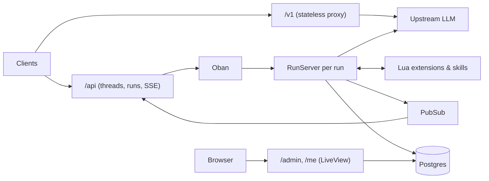

# Meridian — Design

Meridian is a self-hostable **agent layer** between clients and any OpenAI-compatible inference
endpoint. It owns users, agents, conversations, and the run lifecycle, and is extended with
sandboxed Lua scripts. The inference backend is a dumb, stateless model endpoint.

To a client, Meridian looks like an inference endpoint, except that **your credential carries
you**: your agents, your threads, and whatever your extensions add.

This doc describes how things are and why. When it and the code disagree, fix whichever is
wrong. Module docs hold the details; this is the map.

## Principles

- **Durable runs.** Generation happens server-side and doesn't depend on the client staying
  connected. Clients subscribe, leave, and come back.
- **Small core, extensible edges.** The core knows runs, threads, agents, skills, and the hook
  pipeline. Features like memory are extensions; if one can't be written, the extension API is
  missing something.
- **Processes for isolation.** Every run, upstream request, tool call, and script call is its
  own process. Something that hangs or crashes takes down only itself.
- **The operator never reads conversations.** The admin console shows usage and run metadata,
  never content.
- **Generic and environment-agnostic.** The repo is public; everything deployment-specific is
  an env var.
- **Domain/web boundary.** `lib/meridian/` never depends on `lib/meridian_web/`.

## Stack

Elixir/OTP, Phoenix (JSON APIs + LiveView with no asset build), Postgres, Oban (jobs, on
Postgres), Phoenix.PubSub (fan-out), Req (HTTP), the `lua` package (scripts, Lua 5.3 in pure
Elixir). Shipped as a `mix release` in a multi-arch container image.

## Architecture



## Surfaces

### `/v1`: OpenAI-compatible proxy

An agent-aware proxy. The client owns history and the tool loop. No extensions, no
persistence.

- `GET /v1/models` lists agents as `meridian/<slug>` (plus raw upstream models if
  `EXPOSE_UPSTREAM_MODELS`).
- `POST /v1/chat/completions` resolves the agent from `model`, merges the agent's system prompt
  first into the leading system message, applies the agent's params as defaults (client values
  win), and relays the upstream response byte for byte. A client disconnect cancels upstream.
- Model resolution: `meridian/<slug>` → that agent (404 if unknown); a raw upstream id →
  passthrough when exposed; anything else → the key's `default_agent`, else the user's default.

### `/api`: native, stateful

| Route | Purpose |
|---|---|
| `GET /api/agents` | The user's agents |
| `/api/threads` (CRUD) | Threads |
| `GET/POST /api/threads/:id/messages` | History / send a message → `{message, run}` immediately |
| `POST /api/threads/:id/fork` | Copy the thread with its messages `through` one (all if omitted) → the new thread |
| `POST /api/threads/:id/truncate` | Delete the messages `after` one (and the runs of deleted user messages) |
| `POST /api/threads/:id/reply` | Reply again to the last message, if it's a user message → `run` |
| `GET /api/runs/:id`, `POST /api/runs/:id/cancel` | Run status / cancel |
| `GET /api/runs/:id/events` | SSE, resumable via `Last-Event-ID` or `?after=` |
| `/api/auth/*` | Sign-in for browser apps (see Identity) |

- One active run per thread (partial unique index). Sending while busy is a `409`; so is
  deleting or truncating a thread with an active run.
- Rerolling is `truncate` after the user message, then `reply`. Editing a message is `truncate`
  before it, then sending. Branching at a message is `fork` (then `reply` if it ends on one).
- Errors use the OpenAI shape: `{"error": {"message", "type", "code"}}`.
- Browser apps are first-class: CORS from `CORS_ALLOWED_ORIGINS` (never with credentials).
  `EventSource` can't send headers, so runs carry an `events_token` (signed, one run, one hour)
  accepted as `?token=`. A finished run's stream answers a reconnect with `204` so
  `EventSource` stops.

## Runs

A **run** is one agent turn: user message → final assistant message. Each model call plus the
tool calls it asks for is a **step**.

`queued → running → completed | failed | cancelled` (`awaiting_approval` exists, unused).

1. `POST /messages` inserts the message and a queued run in one transaction and enqueues an
   Oban job (`Runs.Worker`), which starts a `RunServer` and lives as long as it.
2. The `RunServer` snapshots the agent, calls hooks, streams from the upstream through a
   separate process (`Upstream.Stream`) that forwards chunks as messages, runs tool calls in
   their own tasks, and repeats until the model answers without tools or `:max_steps` (10) is
   hit.
3. Everything is an **event** with a per-run `seq`: persisted to `run_events`, then broadcast
   on `run:<id>` and `thread:<id>`. Text deltas are coalesced (~100 ms) before both, so live
   and replaying clients see identical events. Types: `run.*`, `message.delta`,
   `message.completed`, `tool_call.started`, `tool_call.completed`. A day after a run
   finishes, its `message.delta` events are deleted (`message.completed` has the same text),
   so an old run replays without the streaming.
4. Subscribers subscribe first, replay from Postgres, then drop live events already replayed.

**Completion is strict:** a reply is saved as completed only if the upstream sent a
`finish_reason`. A truncated stream or invalid event fails the run.

**Failure:** runs aren't retried or resumed. Three layers make sure no run is left hanging: the
`RunServer` traps exits and fails the run in `terminate/2`; the worker fails it if the
`RunServer` dies or can't start; a janitor fails runs whose heartbeat is older than 60 s (dead
node), and queued runs whose job is gone.

**Cancel** goes over PubSub (works across nodes). The partial reply is kept as the assistant
message with `finish_reason: "cancelled"`.

**History rules:** reasoning is stored as a content part and never sent back upstream; a tool
call with no saved result is sent upstream as interrupted, so history is always valid.

## Extensions

An extension is a Lua script stored in the database, edited in the browser, and enabled per
agent. The script returns a table with hooks, `jobs`, `tools`, `settings`, and `validate`. See
`Meridian.Extensions.Script` for the shape and `Meridian.Extensions.Capabilities` for the
`meridian` table.

- **Ownership.** Global (made in `/admin`) or a user's own (made in `/me`). Admins can read and
  edit all; users can read global ones.
- **Enablement.** `agents.extensions` maps extension id → settings; present means enabled, and
  nothing is on by default. Settings are frozen in the run's agent snapshot. Scripts are not:
  a saved script is used from the next call. Missing ids are kept and ignored.
- **Sandbox.** Scripts reach Meridian only through the `meridian` table, always scoped to the
  user the call runs for. Every call runs in its own process, starting from the script's
  loaded state (nothing carries over), with a timeout, a heap cap, and an instruction budget
  (2M). Loaded scripts are cached per node by source hash.
- **Failure.** A crashing or hanging handler is logged, shown on the extension's page, and
  skipped (fail-open), except `tool_call`, which blocks the call (fail-closed). A script never
  takes down a run.
- **Sync and async.** A hook is a point in the lifecycle; a script subscribes a handler to it.
  The run waits for handlers (30 s each, enough for a model call); background work is a job
  the handler queues with `meridian.jobs.enqueue` (1 min).

### Hooks

Called from the `RunServer` (and `run_end` from wherever the run ended, after commit), in
extension name order. Chained hooks return the changed value or nothing.

| Hook | Gets / may change | Per |
|---|---|---|
| `run_start` | Observe | run |
| `before_run` | System prompt sections, params, tool set (may remove or reword tools, not add). May reject the run | run |
| `context` | History about to be sent (inject, trim, rewrite) | step |
| `before_model_request` | Final request body | step |
| `tool_call` | Name + arguments. May block | tool call |
| `tool_result` | Result text | tool call |
| `message_end` | Finished assistant message content | message |
| `step_end` | Observe | step |
| `run_end` | Observe; enqueue jobs | run |
| `thread_created`, `thread_deleted` | Observe (agent's current settings) | thread |

`model_stream_event` exists but isn't available to scripts (too hot).

### Tools

Tools live in the script under `tools` (description, JSON Schema `parameters`, `run`). Enabling
an extension enables all its tools. The model sees them as `<extension>__<tool>`; the tool set
is fixed for the run after `before_run`. Calls of one step run concurrently.

**Failures are results:** an unknown tool, bad arguments, a block, an error, or a timeout gives
the model `Error: ...`. Limits: 30 s per call, results cut at 20,000 characters. Tool calls are
approved automatically.

## Skills

A skill is a name, a description, and a prompt; global or a user's own (a user's own replaces a
global one with the same name), enabled per agent by id. Core data, not an extension: writing
one is filling in a form.

Delivered by **progressive disclosure**: the system prompt lists enabled skills' names and
descriptions, and the core `load_skill` tool returns a prompt when the model asks. Both go
through hooks like everything else. A skill can recommend extensions; missing ones are only a
warning in the agent form.

## Identity and access

Users are created by the operator only (by hand or by accepting an access request); there is
no signup. Credentials are never shared between roles:

| Credential | Who → what |
|---|---|
| API key (`mrd_…`, SHA-256 hashed, with a policy: `default_agent`, `allowed_agents`) | User → `/v1`, `/api` |
| OIDC access token (`OIDC_AUDIENCES`) | User → `/v1`, `/api`, for clients that run their own login |
| `/api/auth` cookie session | User → `/api`, for same-origin browser apps (Meridian runs the login, because providers don't allow CORS on token exchange). Mutations need `X-Requested-With` |
| `/me` session | User → their own `/me` |
| Admin sign-in (`ADMIN_EMAILS` allowlist) or `ADMIN_TOKEN` | Operator → `/admin` |

All sign-ins use one OIDC client (code + PKCE, `state`, `nonce`; hand-rolled with Req and
`:crypto`, RS256 only). A first sign-in links to the user by verified email; a linked user is
never relinked.

## Web areas

All LiveView, hand-written CSS, no asset build.

- **`/admin`**: the operator console (green). **Operate**: users, access requests, runs (live
  event types and timings, never payloads). **Configure**: everyone's agents, skills,
  extensions.
- **`/me`**: the user's own area (amber), with the same Configure group, scoped to their
  things. 404 unless OIDC is configured.
- **`/me/request`**: public access requests. The answer is the same whatever the email (it
  doesn't reveal who has access), there's one request per email (asking again bumps it), and
  open requests are capped at 200. The operator accepts (creates the user with a default
  agent), snoozes, or rejects (kept, so the email can't ask again).

## Data model

UUIDv7 ids (monotonic), `utc_datetime_usec` timestamps.

```text
users            id, name, email, oidc_issuer?, oidc_subject?
api_keys         id, user_id, name, prefix, token_hash, policy, last_used_at, revoked_at
agents           id, user_id, slug, name, system_prompt, model, params, extensions, skills, is_default
threads          id, user_id, agent_id, title
messages         id, thread_id, run_id?, role, content (parts), tool_calls?, tool_call_id?, metadata, usage?
runs             id, thread_id, user_message_id, status, agent_snapshot, usage, error?, heartbeat_at, ...
run_events       run_id, seq, type, payload               -- PK (run_id, seq)
extensions       id, name, source, user_id?               -- no user = global
skills           id, name, description, prompt, recommended_extensions, user_id?
access_requests  id, email, name?, status, times_requested, requested_at
```

Columns are added when a feature needs them, not ahead of time.

## Configuration

| Variable | Purpose |
|---|---|
| `DATABASE_URL`, `POOL_SIZE` | Postgres |
| `SECRET_KEY_BASE`, `PHX_HOST`, `PORT`, `PHX_SERVER` | Phoenix |
| `LLM_BASE_URL`, `LLM_API_KEY` | Upstream |
| `EXPOSE_UPSTREAM_MODELS` | Also list raw upstream models on `/v1/models` |
| `CORS_ALLOWED_ORIGINS` | Browser origins for `/v1` and `/api` |
| `OIDC_ISSUER`, `OIDC_CLIENT_ID`, `OIDC_CLIENT_SECRET` | Sign-in (turns on `/me` and `/api/auth`) |
| `OIDC_AUDIENCES` | Client ids whose access tokens the APIs accept |
| `ADMIN_EMAILS`, `ADMIN_TOKEN` | Admin access (neither = `/admin` off) |
| `DNS_CLUSTER_QUERY` | Clustering |

Development also reads `.env` (shell variables win).

## Deployment

A multi-arch image (built on native runners) on GHCR. Kustomize bases in `deploy/` (see
`deploy/README.md`); hosts and secrets go in the operator's own overlay. Health probes are
exempt from `force_ssl`. Single node for now; PubSub-based cancel and per-node registries keep
clustering open.

## Decision log

Current decisions only. Superseded ones are removed; git history has them.

| Decision | Instead of | Why |
|---|---|---|
| Elixir/OTP | TS, Rust, Python | Long-lived, crash-tolerant sessions that outlive connections and fan out is what OTP is for. |
| Postgres + Oban + PubSub | Redis/NATS, Temporal | One stateful dependency. Durable execution frameworks are overkill for one operator. |
| Stateless `/v1` + stateful `/api` | One of them | Generic clients only speak Chat Completions; durable threads need server-owned state. |
| `/v1` is a pure proxy, relayed byte for byte | Server tools/memory on `/v1` | Mixing server and client tool calls in a stateless response is messy. |
| Agents are exposed as model ids | Custom headers | Works in every OpenAI client unchanged. |
| Memory is an extension | Memory in core | The memory design is undecided, and it's the real test of the extension API. |
| Admin console never shows conversation content | Showing everything | Running Meridian for friends shouldn't mean reading their chats. |
| Operator and user credentials never mix | Admin scope on user keys | Different roles; a bug in `/me` can't open `/admin`. Also no bootstrap command. |
| Meridian runs OIDC login for browser apps | Resource-server only | WorkOS doesn't allow CORS on token exchange for OAuth apps. One OIDC client for every sign-in; `ADMIN_EMAILS` separates roles. |
| Sign-ins link by verified email; no signup | Auto-creating users | Users stay operator-created. Never relinking prevents takeover. |
| Public access requests reveal nothing and are capped | Signup; telling people they have access | Friends can ask without exposing who uses it. |
| Deltas coalesced before broadcast | Live tokens, coalesced persistence | One event sequence: live and replay identical, trivial dedupe. |
| `RunServer` never blocks, on upstream or on hooks | Calling Req or scripts inline | A blocked server can't cancel or heartbeat, and the janitor would kill a live run. Each hook runs in one task; the server waits for its message. |
| Strict completion (needs `finish_reason`) | Treating end of body as success | A dropped connection must not be saved as a full answer. |
| No retry/resume; fail fast (3 layers) | Oban retries + checkpointed steps | Frees the thread instead of leaving it stuck. Resume needs `run_steps`. |
| Partial replies kept on cancel | Discarding | The user saw that text. |
| Fork, truncate, and reply as primitives; forks copy messages | Reroll/edit endpoints; reply variants in place; threads pointing at a parent | Three plain operations compose into reroll, edit, and branching. Copies keep history queries flat and branches independent of their origin. |
| Extensions are sandboxed Lua in the DB | Elixir modules, Deno, QuickJS, WASM | Edit-and-save without a deploy, safe for users to write, pure Elixir. Cost: no deps, slow interpreter. |
| Script calls start from loaded state; cached by source hash | Live Lua state per extension | No leakage between users or runs, no cache invalidation. |
| Timeout + heap cap + instruction budget per call | Timeout only | Deterministic failure for runaway loops; scripts can't grow the node. |
| Every lifecycle hook exists, used or not | Hooks on demand | Extensions shouldn't need a core change first. |
| Hooks are always awaited; jobs are the async path | A per-extension sync/async switch | Hooks see the run in order and may change it. Background work is a hook that enqueues a job: one way to do it. |
| Deltas of finished runs are deleted after a day | Keeping every event | Deltas are most of `run_events` and repeat `message.completed`. Replaying a recent run stays exact. |
| Hooks may call the model, with a 30 s limit like tools | Forbidding model calls in hooks; jobs only | Guardrails (e.g. a small model checking a tool call) must finish before the run goes on. The latency is the extension's choice. |
| Extensions enabled per agent by id, off by default | Global enablement; by name | Per-user control; user and global extensions may share names. |
| Tools are part of extensions; all-or-nothing enablement | Separate tool rows; per-tool switches | One feature = one script sharing code and settings. Optional parts are settings. |
| Tool failures are results for the model | Failing the run | Models recover well from `Error: ...`. |
| `context` and `before_model_request` run every step | Once per run | Extensions must see earlier steps' tool messages. |
| Skills are core data, delivered by progressive disclosure | A skills extension; full prompts every request | A skill is content, not code; descriptions keep requests small. |
| Everything says "agent" (was "persona") | Two words | Breaking renames are fine; clients are ours. Data was migrated. |
| No asset build | Tailwind/esbuild | No Node toolchain; strict CSP. |
| Kustomize bases | Helm | Plain YAML; deployment values stay out of this repo. |

## Open questions

1. Should any hooks run on `/v1`, or does it stay a pure proxy forever?
2. Per-run extension state: where does it live, and does it survive a crash?
3. Is extension name order enough, or do extensions need priorities or dependencies?
4. Extension KV storage: what happens to the data when an extension is deleted?
5. Should agents whose upstream model disappears be flagged?
